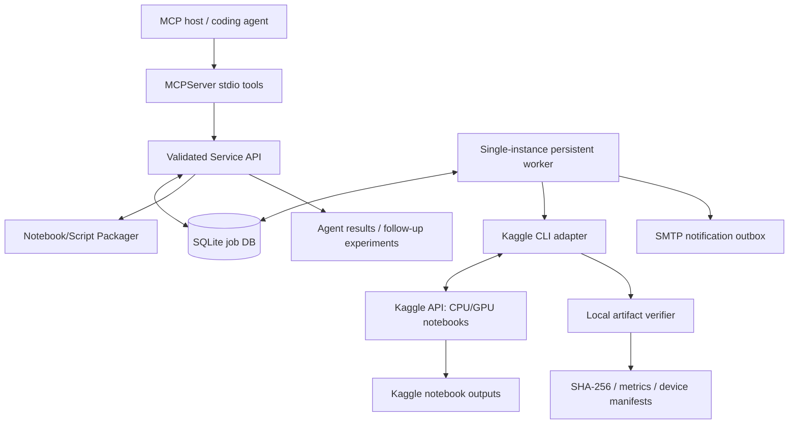

# Architecture — Kaggle GPU MCP

## Trust and execution boundaries

- The MCP tool layer validates parameters and delegates to `Service`. User-approved code is pulled only from the configured workspace; arbitrary shell execution is unavailable.
- Notebook packaging generates one **unique private** Kaggle reference per job. The adapter executes a fixed CLI command allowlist without shell interpolation.
- An independent worker polls until completion, stores artifacts on disk, and updates SQLite with job transitions.
- A dependent training job is queued only after CPU preparation outputs are downloaded/verified. It mounts the preparation Kaggle notebook output by `kernel_sources`.
- Completion and failure create outbox rows; the email dispatcher processes them independently.
- The AI model is **not embedded inside** the MCP server. An MCP host uses the tools to decide what code and evaluation steps to run.

## States

`QUEUED -> SUBMITTING -> SUBMITTED -> RUNNING/QUEUED_REMOTE -> DOWNLOADING -> COMPLETED`.

`FAILED` is terminal. `WAITING` indicates unresolved workflow dependency. A timeout during upload produces `SUBMISSION_UNKNOWN`, requiring explicit `kaggle_reconcile_job` to avoid duplicate runs. A worker restart during `SUBMITTING` also resolves to this conservative state.

## Dataset and storage strategies

- `dataset_sources`: Kaggle-owned or licensed datasets, already available on Kaggle.
- `kernel_sources`: outputs of a prior completed Kaggle notebook (e.g. `merged.csv`).
- Publishing local CSV files uses a private Kaggle dataset and the Kaggle CLI dataset create/version workflow.
- Jobs/metadata/audit: local SQLite. Logs and artifacts: local filesystem under workspace.
- Automatic remote raw-data crawling is **not included**; projects require tailored source connectors and review.

## Recovery/notifications

- Worker process must be running to monitor remote status and deliver emails.
- Kaggle remote runtime continues independent of the MCP host once submitted, subject to provider availability.
- If the local worker stops and restarts, the DB's submitted IDs allow it to resume polling.
- If the worker stops during an in-progress upload, the push may have been accepted; default is *not* to resubmit.
- Completion notifications are sent once per job; SMTP delivery failures are retried up to three times. An unconfigured channel results in SKIPPED notifications.

## Future enhancements (not currently implemented)

Authenticated remote HTTP deployment, multiple distributed worker leases, automatic approved public-API source ingestion, robust large-scale column mapping and dataset lineage, automatically optimized hyperparameter search under budgets, and actual multi-provider GPU scheduling.
